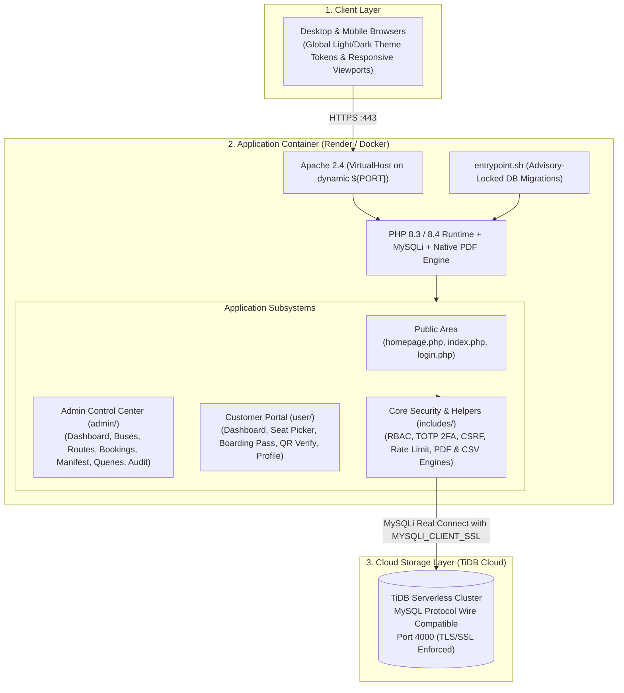

# 🏗️ Architecture & System Design

## 1. System Topology

The Bus Reservation System uses a lightweight, modular monolithic PHP architecture. It operates within a Dockerized Linux runtime running Apache 2.4 and PHP 8.3 / 8.4, connecting over an encrypted TLS channel to an external serverless MySQL database (TiDB Cloud).



---

## 2. Directory Layout & Modular Responsibilities

The codebase is organized into isolated functional domains:

```
Bus-Reservation/
├── index.php                 # Canonical entry point (redirects to homepage.php)
├── homepage.php              # Public landing page, login modals & PNR status check
├── login.php                 # Standalone login endpoint
├── admin.php                 # Backward-compatibility shim (redirects to admin/index.php)
│
├── admin/                    # 👑 Administrator Management Subsystem
│   ├── index.php             # Dashboard entry point
│   ├── dashboard.php         # Real-time KPIs, Attention Center, Today's Departures & Analytics
│   ├── buses.php             # Fleet management (capacity 10–60, layouts & soft-delete)
│   ├── routes.php            # Route schedules, KPI cards, smart filters & collision checks
│   ├── customers.php         # Customer directory, search, CSV export & archiving
│   ├── bookings.php          # Booking management, multi-criteria filters & bulk actions
│   ├── seats.php             # Live seat occupancy monitor with departure filters
│   ├── manifest.php          # Passenger trip manifest (PDF generator, mobile card, CSV & print)
│   ├── queries.php           # Customer inquiry inbox & modal email reply workflow
│   ├── audit-log.php         # Immutable audit trail, visual diffs & compliance logs
│   ├── add-admin.php         # Administrator provisioning & account governance
│   ├── profile.php           # Profile management, password rotation & TOTP 2FA setup
│   ├── mfa.php               # Two-Factor Authentication login challenge controller
│   ├── diagnostics.php       # Operational integrity & security diagnostics
│   └── edit/                 # ✏️ Inline Record Editing Subsystem
│       ├── edit-booking.php
│       ├── edit-bus.php
│       ├── edit-route.php
│       └── edit-customer.php
│
├── user/                     # 🧑‍💼 Customer Passenger Portal
│   ├── index.php             # Customer dashboard, upcoming journey card & custom city dropdowns
│   ├── booking.php           # Reservation engine, fluid seat map & sticky mobile summary bar
│   ├── my-bookings.php       # Personal booking history, status tabs & cancellation
│   ├── profile.php           # Account security, password rotation, email change & deactivation
│   ├── ticket.php            # Digital boarding pass, QR code & Native Web Share integration
│   └── verify.php            # Public QR boarding pass verification endpoint
│
├── includes/                 # 🔧 Core Framework & Security Libraries
│   ├── config.php            # Dynamic BASE_URL detector, global error handling & env defaults
│   ├── db_con.php            # Environment-driven database connector with TLS/SSL support
│   ├── helpers.php           # Prepared statements, create_booking(), PDF generator, CSRF, CSV streaming
│   ├── admin-crud.php        # Shared admin CRUD helpers, soft-delete & UI components
│   ├── auth/
│   │   ├── session-bootstrap.php # Hardened session manager & secure cookie policy
│   │   ├── admin-session.php # Admin session authentication guard & live role checks
│   │   ├── user-session.php  # Customer session authentication guard
│   │   └── totp.php          # RFC 6238 TOTP engine, AES-256-GCM encryption & recovery codes
│   └── layout/
│       ├── header-public.php # Homepage header
│       ├── header-login.php  # Login page header
│       ├── header-admin.php  # Admin sidebar, SVG sprite system, topbar & cache-busting
│       ├── header-user.php   # Customer sidebar, SVG sprite system, topbar & cache-busting
│       ├── header-edit.php   # Edit pages header
│       ├── footer.php        # Public & edit footer scripts
│       ├── footer-admin.php  # Admin footer scripts & drawer controller
│       └── footer-user.php   # Customer footer scripts & idle timeout integration
│
├── assets/                   # 🎨 Stylesheets, Scripts & Vector Brand Assets
│   ├── css/
│   │   ├── design-system.css # Global Light (White) & Dark (Slate) design tokens
│   │   ├── admin.css         # Admin workspace, topbar, sidebar & table styles
│   │   ├── admin-mobile-responsive.css # Responsive mobile drawer & card adaptations
│   │   ├── dashboard.css     # Attention Center, Today's Departures & Analytics styles
│   │   ├── user.css          # Customer portal, boarding pass & custom dropdown styles
│   │   ├── seat-map.css      # Fluid seat map grid & sticky mobile booking bar
│   │   └── home.css          # Public landing page styles
│   ├── js/
│   │   ├── admin-mobile.js   # Accessible off-canvas drawer & swipe gesture controller
│   │   ├── perf-chart.js     # Chart.js dual-axis booking/revenue & status donut charts
│   │   ├── theme-toggle.js   # Persistent Light/Dark theme switcher
│   │   └── user-idle.js      # Customer session idle warning & auto-logout monitor
│   └── images/
│       └── bus.svg           # High-definition vector bus brand icon
│
├── database/                 # 🗄️ Relational Schema & Migration Engine
│   ├── init.sql              # Idempotent hardened schema DDL
│   ├── db_migrate.php        # Robust database migration runner with advisory locking
│   └── migrations/           # Sequential Schema Migrations (001 to 010)
└── tests/                    # 🧪 Automated Test Harnesses
```

---

## 3. UI Design System & Global Theme Architecture

The frontend uses a centralized CSS custom property token system (`assets/css/design-system.css`) shared across both the Customer Portal (`user/`) and Administrator Control Center (`admin/`):

1. **Global Light (White) & Dark (Slate) Theme Tokens:**
   - **Light Mode (`:root`):** Crisp pure-white navigation sidebar and card surfaces (`--sidebar-bg: #ffffff`, `--surface: #ffffff`), slate typography (`--text-primary: #0f172a`), and royal blue active accents (`#2563eb`).
   - **Dark Mode (`[data-theme="dark"]`):** Deep midnight navy surfaces (`--sidebar-bg: #0f172a`, `--bg-body: #0b1120`) with high-contrast slate text (`#f8fafc`) and glowing indigo accents.
   - Controlled persistently via `assets/js/theme-toggle.js` and `localStorage.getItem('busres_theme')`.
2. **Inline SVG Vector Sprite System & Brand Emblem:**
   - Both `includes/layout/header-admin.php` and `includes/layout/header-user.php` embed an inline `<svg>` symbol sprite sheet alongside the vector bus brand icon (`assets/images/bus.svg`).
   - Sticky glassmorphic topbars (`backdrop-filter: blur(14px)`) display semantic section eyebrow pills (`OVERVIEW`, `FLEET & ROUTES`, `BOOKINGS & TRIPS`, `ACCOUNT`, `SUPPORT`, `GOVERNANCE`) and active page headers.
3. **Automatic Asset Cache-Busting:**
   - Stylesheet references append `?v=filemtime(...)` dynamically so CSS updates take effect immediately across browser sessions without stale cache artifacts.
4. **Responsive Off-Canvas Navigation Drawer (`<992px`):**
   - `assets/js/admin-mobile.js` powers an accessible mobile navigation drawer (`min(86vw, 320px)`) with swipe-to-dismiss gesture detection, focus trapping, `inert` background locking, and `44x44px` minimum touch targets.

---

## 4. Request Lifecycle & Routing

1. **Initial Entry:** A visitor accessing the root URL (`/`) hits `index.php`, which fires an HTTP 302 redirect to `homepage.php`.
2. **Public Operations:** `homepage.php` renders the hero search section with accessible custom city dropdowns, two-factor public PNR lookup, contact inquiry submission, and modal login dialogs.
3. **Authentication Handshake:**
   - **Administrator Login:** Verifies credentials against the `admin` table (`password_verify()`), enforces rate limits, checks TOTP 2FA status (`admin/mfa.php`), initializes isolated `$_SESSION['admin_id']` state, and routes to `/admin/dashboard.php`.
   - **Customer Login:** Verifies credentials against the `costumer` table, initializes `$_SESSION['uid']`, and routes to `/user/index.php`.
4. **Live Session & RBAC Protection:**
   - Every administrative page includes `includes/auth/admin-session.php`, which validates `is_active`, `role`, and `password_changed_at` against the database on every request.
   - Every customer page includes `includes/auth/user-session.php`.
5. **Backwards Compatibility:** Legacy links to `/admin.php` are intercepted by the root redirect shim and forwarded cleanly to `/admin/index.php`.
