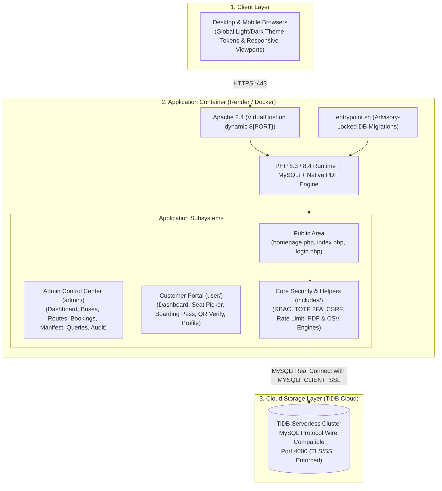

# 🏗️ Architecture & System Design

## 1. System Topology

The Bus Reservation System uses a lightweight, modular monolithic PHP architecture. It operates within a Dockerized Linux runtime running Apache 2.4 and PHP 8.3 / 8.4, connecting over an encrypted TLS channel to an external serverless MySQL database (TiDB Cloud).



---

## 2. Directory Layout & Modular Responsibilities

The codebase is organized into isolated functional domains:

```
Bus-Reservation/
├── index.php                 # Canonical entry point (redirects to homepage.php)
├── homepage.php              # Public landing page, login modals, Google SSO, carousels & PNR lookup
├── login.php                 # Standalone customer login endpoint (password & Google SSO)
├── pnr.php                   # Standalone PNR lookup endpoint (Web Share & protocol handler)
├── loading.html              # Standalone animated splash & loading screen
├── forgot-password.php       # Customer password reset link request endpoint
├── reset-password.php        # Single-use SHA-256 hashed token password reset completion
├── google-login.php          # Google OAuth 2.0 / OpenID Connect authorization redirector
├── google-callback.php       # Google OAuth 2.0 PKCE token exchange & customer login handler
├── google-reauth.php         # Fresh Google re-authentication challenge for sensitive actions
├── admin.php                 # Backward-compatibility shim (redirects to admin/index.php)
├── manifest.json             # PWABuilder-compliant Web App Manifest (Widgets, Shortcuts, Handlers)
├── sw.js                     # Service Worker (Cache-First static, Network-First dynamic, Background Sync)
├── offline.html              # Branded offline fallback screen for network outages
├── .env.example              # Reference environment configuration template
│
├── android/                  # 🤖 Android TWA Native App Package
│   ├── BusBook-v2.4.0.apk    # Signed production release APK for direct installation
│   ├── app-release.aab       # Production Android App Bundle for Google Play Store
│   ├── busbook-release.keystore # RSA 2048-bit release signing keystore
│   └── app/                  # Android Studio TWA project & launcher resources
│
├── admin/                    # 👑 Administrator Management Subsystem
│   ├── index.php             # Dashboard entry point
│   ├── dashboard.php         # Real-time KPIs, Attention Center, Today's Departures & Analytics
│   ├── buses.php             # Fleet management (capacity 10–60, layouts & soft-delete)
│   ├── routes.php            # Route schedules, KPI cards, smart filters & collision checks
│   ├── customers.php         # Customer directory, search, CSV export & archiving
│   ├── bookings.php          # Booking management, multi-criteria filters & bulk actions
│   ├── seats.php             # Live seat occupancy monitor with departure filters
│   ├── manifest.php          # Passenger trip manifest (PDF generator, mobile card, CSV & print)
│   ├── queries.php           # Customer inquiry inbox & modal email reply workflow
│   ├── audit-log.php         # Immutable audit trail, visual diffs & compliance logs
│   ├── add-admin.php         # Administrator provisioning & account governance
│   ├── profile.php           # Profile management, password rotation & TOTP 2FA setup
│   ├── mfa.php               # Two-Factor Authentication login challenge controller
│   ├── diagnostics.php       # Operational integrity & security diagnostics
│   ├── includes/             # 🛠️ Admin View Partials
│   │   └── footer.php        # Minimalist admin utility bar (version, server status, copyright)
│   └── edit/                 # ✏️ Inline Record Editing Subsystem
│       ├── edit-booking.php
│       ├── edit-bus.php
│       ├── edit-route.php
│       └── edit-customer.php
│
├── user/                     # 🧑‍💼 Customer Passenger Portal
│   ├── index.php             # Customer dashboard, upcoming journey card & custom city dropdowns
│   ├── booking.php           # Reservation engine, fluid seat map & sticky mobile summary bar
│   ├── my-bookings.php       # Personal booking history, status tabs & cancellation
│   ├── profile.php           # Account security, Google re-auth, credential badges & deactivation
│   ├── ticket.php            # Mobile-optimized boarding pass, 1-tap PNR copy, QR code & Web Share
│   └── verify.php            # Public QR boarding pass verification endpoint
│
├── includes/                 # 🔧 Core Framework & Security Libraries
│   ├── config.php            # Dynamic BASE_URL detector, global error handling & env defaults
│   ├── db_con.php            # Environment-driven database connector with TLS/SSL support
│   ├── helpers.php           # Prepared statements, get_app_url(), PDF generator, CSRF, CSV streaming
│   ├── footer.php            # Modern 4-column responsive web footer & PWA install action
│   ├── bottom-nav.php        # Native-style fixed bottom navigation bar (standalone PWA & mobile)
│   ├── google-auth.php       # Google OAuth 2.0/OIDC engine, PKCE, token verification & re-auth
│   ├── password-reset.php    # Email reset-link flow, SHA-256 token hashing & anti-enumeration engine
│   ├── smtp.php              # Dual-transport email delivery (Brevo HTTPS REST API & RFC 5321 SMTP)
│   ├── admin-crud.php        # Shared admin CRUD helpers, soft-delete & UI components
│   ├── auth/
│   │   ├── session-bootstrap.php # Hardened session manager & secure cookie policy
│   │   ├── admin-session.php # Admin session authentication guard & live role checks
│   │   ├── user-session.php  # Customer session authentication guard
│   │   └── totp.php          # RFC 6238 TOTP engine, AES-256-GCM encryption & recovery codes
│   └── layout/
│       ├── header-public.php # Homepage header with user profile pill & dropdown
│       ├── header-login.php  # Login page header
│       ├── header-admin.php  # Admin sidebar, SVG sprite system, topbar & cache-busting
│       ├── header-user.php   # Customer sidebar, SVG sprite system, topbar & cache-busting
│       ├── header-edit.php   # Edit pages header
│       ├── pwa-head.php      # Path-aware PWA manifest, meta tags & service worker injector
│       ├── google-button.php # Accessible "Continue with Google" button component
│       ├── footer.php        # Public & edit footer scripts
│       ├── footer-public.php # Backward-compatible public footer proxy
│       ├── footer-admin.php  # Admin footer scripts & drawer controller
│       └── footer-user.php   # Customer footer scripts & idle timeout integration
│
├── assets/                   # 🎨 Stylesheets, Scripts, Vendor Libraries & Vector Assets
│   ├── vendor/               # 📦 Self-Hosted Dependencies (Zero CDN tracking warnings)
│   │   ├── bootstrap/        # Bootstrap 4.6.2 CSS & bundle JS
│   │   └── jquery/           # jQuery 3.5.1 production minified runtime
│   ├── css/
│   │   ├── design-system.css # Global Light (White) & Dark (Slate) design tokens
│   │   ├── footer.css        # Scoped 4-column footer, dark-slate tokens & PWA media queries
│   │   ├── admin.css         # Admin workspace, topbar, sidebar & table styles
│   │   ├── admin-mobile-responsive.css # Responsive mobile drawer & card adaptations
│   │   ├── dashboard.css     # Attention Center, Today's Departures & Analytics styles
│   │   ├── user.css          # Customer portal, mobile boarding pass & custom dropdown styles
│   │   ├── seat-map.css      # Fluid seat map grid & sticky mobile booking bar
│   │   ├── preloader.css     # Cinematic 3D preloader & transit overlay animation
│   │   ├── home.css          # Public landing page styles & user profile pill navbar
│   │   └── theme-emerald.css # Emerald Cyber (Theme B) Dark Mode design system
│   ├── js/
│   │   ├── admin-mobile.js   # Accessible off-canvas drawer & swipe gesture controller
│   │   ├── perf-chart.js     # Chart.js dual-axis booking/revenue & status donut charts
│   │   ├── theme-toggle.js   # Persistent Light/Dark theme switcher
│   │   ├── preloader.js      # Global preloader transition controller
│   │   ├── pwa-install.js    # Progressive Web App installation prompt controller
│   │   └── user-idle.js      # Customer session idle warning & auto-logout monitor
│   └── images/
│       ├── bus.svg           # High-definition vector bus brand icon
│       ├── bus-emblem.png    # High-resolution BusBook brand emblem
│       └── pwa/              # 192x192, 512x512 standard & maskable application icons
│   └── partials/
│       ├── _preloader.php    # Path-aware brand preloader overlay partial
│       └── _pwa-head.php     # Path-aware PWA head tags & Service Worker register
│
├── database/                 # 🗄️ Relational Schema & Migration Engine
│   ├── init.sql              # Idempotent hardened schema DDL
│   ├── db_migrate.php        # Robust database migration runner with advisory locking
│   ├── create-admin.php      # CLI administrator provisioning script
│   ├── reset-mfa.php         # CLI emergency break-glass 2FA reset script
│   ├── expire-holds.php      # CLI expired seat hold release utility
│   ├── purge-audit-log.php   # CLI audit log retention cleanup utility
│   └── migrations/           # Sequential Schema Migrations (001 to 013)
└── tests/                    # 🧪 Automated Test Harnesses (28+ suites, 600+ assertions)
```

---

## 3. UI Design System, PWA & Global Theme Architecture

The frontend uses a centralized CSS custom property token system (`assets/css/design-system.css`) shared across both the Customer Portal (`user/`) and Administrator Control Center (`admin/`):

1. **High-Fidelity Light Mode & Scoped Emerald Cyber Theme B Dark Mode:**
   - **Light Mode (`:root`):** Crisp pure-white navigation sidebar and card surfaces (`--sidebar-bg: #ffffff`, `--surface: #ffffff`), slate typography (`--text-primary: #0f172a`), and royal blue active accents (`#2563eb`).
   - **Emerald Cyber Dark Mode (`[data-theme="dark"]`, `assets/css/theme-emerald.css`):** Deep Obsidian canvas (`#050C0F`), Dark Pine surfaces (`#081216`), Elevated Teal accents (`#0F222A`), Mint Emerald primary CTA (`#10B981`), and Sky Cyan interactive highlights (`#06B6D4`). Enforces strict CSS scoping so dark tokens never pollute the crisp light theme.
   - Controlled persistently via `assets/js/theme-toggle.js` and `localStorage.getItem('busres_theme_mode')`.
2. **Modern Passenger Profile Pill & Navbar:**
   - `includes/layout/header-public.php` renders a unified profile pill for logged-in passengers featuring a gradient avatar circle with passenger initials, one-line layout (`white-space: nowrap;`), quick shortcuts to Dashboard, My Bookings, and Account Settings, and an isolated CSRF signout link.
3. **Modern 4-Column Web Footer & PWA Standalone Bottom Navigation:**
   - Separates desktop web utility (`includes/footer.php`) from standalone mobile app navigation (`includes/bottom-nav.php`).
   - Web footer (`.website-only-footer`) renders a 4-column responsive grid on desktop (Brand & PWA action, Quick Links, Top Routes, and Support/Trust badges) and stacks neatly to 1-column on mobile viewports (`<768px`).
   - Native-style fixed bottom navigation bar (`.pwa-bottom-nav`) provides 4-tab 1-tap navigation (Home, Search, My Tickets, Profile) with safe-area notch padding (`env(safe-area-inset-bottom)`).
   - In installed PWA mode (`@media all and (display-mode: standalone)`), CSS rules automatically hide the heavy web footer and display the sleek mobile bottom bar.
4. **Touch-First Mobile Carousels & 5-Second Autoplay:**
   - On viewports `<768px`, the Features and Popular Routes sections automatically transform into swipeable carousels with native CSS scroll-snap (`scroll-snap-type: x mandatory`), 44px side navigation arrows, dot indicators, and synchronized 5-second auto-scroll with pause-on-touch interaction.
5. **Cinematic Transit Preloader & Self-Hosted Assets:**
   - Eliminates external CDN dependencies by self-hosting Bootstrap 4.6.2 and jQuery 3.5.1 in `assets/vendor/`, preventing browser tracking-prevention blocks.
   - Smooth page transitions with BusBook's animated preloader (`assets/js/preloader.js`, `loading.php`).
6. **Minimalist Admin Utility Bar:**
   - `admin/includes/footer.php` delivers a streamlined, single-line utility strip across administrative pages displaying the release version (`BusBook v2.4.0`), operational health indicator, database engine info, and dynamic copyright.
7. **Inline SVG Vector Sprite System & Brand Emblem:**
   - Both `includes/layout/header-admin.php` and `includes/layout/header-user.php` embed an inline `<svg>` symbol sprite sheet alongside the vector bus brand icon (`assets/images/bus.svg`).
   - Sticky glassmorphic topbars (`backdrop-filter: blur(14px)`) display semantic section eyebrow pills (`OVERVIEW`, `FLEET & ROUTES`, `BOOKINGS & TRIPS`, `ACCOUNT`, `SUPPORT`, `GOVERNANCE`) and active page headers.
8. **Automatic Asset Cache-Busting:**
   - Stylesheet references append `?v=filemtime(...)` dynamically so CSS updates take effect immediately across browser sessions without stale cache artifacts.
9. **Responsive Off-Canvas Navigation Drawer (`<992px`):**
   - `assets/js/admin-mobile.js` powers an accessible mobile navigation drawer (`min(86vw, 320px)`) with swipe-to-dismiss gesture detection, focus trapping, `inert` background locking, and `44x44px` minimum touch targets.
10. **Option 2 Mobile Card Architecture vs. Desktop Table Layout Integrity:**
   - On mobile viewports (`<= 768px`), all administrative tables (`.buses-table`, `.bookings-table`, `.queries-table`, `.customers-table`) transform into tailored card components with 24px vertical separation and borderless wrappers.
   - On desktop viewports (`min-width: 769px`), layout integrity rules strictly enforce `display: table-row !important` on rows and `display: table-cell !important` on cells, preventing flexbox or CSS grid collapse.
   - Fleet vehicle rows use `.fleet-bus-row`, strictly eliminating class collisions with passenger cabin seat rows (`.bus-seats-grid .bus-row, div.bus-row`).
11. **Full-Platform Pure-PHP Vector PDF Reporting Engine:**
   - Zero external runtime binaries (avoiding wkhtmltopdf, dompdf, or Node headless browsers).
   - In-memory vector PDF 1.4 compilation (`generate_manifest_pdf_doc()`) generating branded, paginated, and print-ready reports across Manifests, Customers, Bookings, and Audit Trail.

---

## 4. Request Lifecycle & Routing

1. **Initial Entry:** A visitor accessing the root URL (`/`) hits `index.php`, which fires an HTTP 302 redirect to `homepage.php`.
2. **Public Operations:** `homepage.php` renders the hero search section with accessible custom city dropdowns, real-time PNR ticket tracker with precision horizontal baseline alignment (`#pnr`, `pnr.php`), contact inquiry submission, and modal login dialogs.
3. **Authentication Handshake:**
   - **Administrator Login:** Verifies credentials against the `admin` table (`password_verify()`), enforces rate limits, checks TOTP 2FA status (`admin/mfa.php`), initializes isolated `$_SESSION['admin_id']` state, and routes to `/admin/dashboard.php`.
   - **Customer Login:** Verifies credentials against the `costumer` table, initializes `$_SESSION['uid']`, and routes to `/user/index.php`.
4. **Live Session & RBAC Protection:**
   - Every administrative page includes `includes/auth/admin-session.php`, which validates `is_active`, `role`, and `password_changed_at` against the database on every request.
   - Every customer page includes `includes/auth/user-session.php`.
5. **Backwards Compatibility:** Legacy links to `/admin.php` are intercepted by the root redirect shim and forwarded cleanly to `/admin/index.php`.
