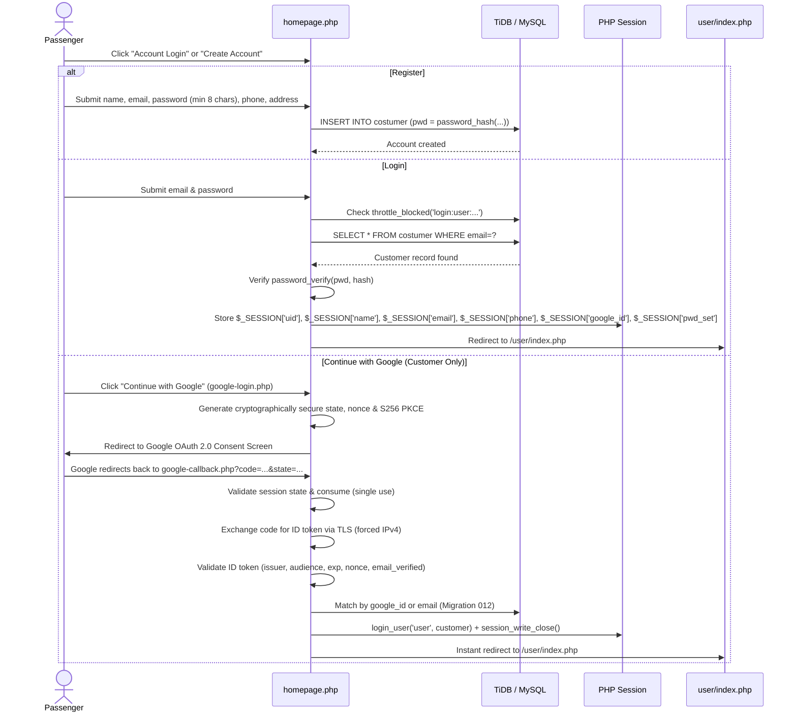
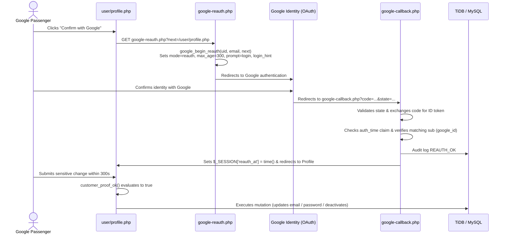
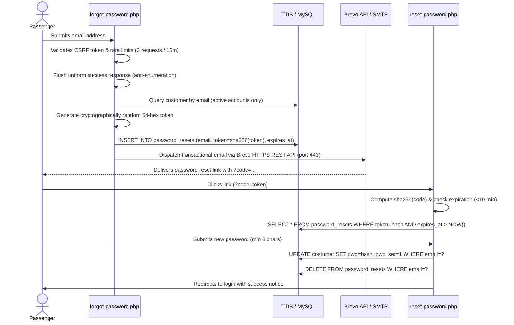

# 🧑‍💼 Customer Portal & Booking Flow

The **Customer Portal** (`user/`) allows passengers to search routes, view real-time seat availability counts, reserve bus seats via an interactive dynamic seat picker, and manage their reservations.

---

## 1. Customer Authentication Flow

> [!NOTE]
> **Google Sign-In is strictly customer-facing.** The Administrator Portal (`admin/`) does not accept Google OAuth and strictly requires username, strong password, and optional Multi-Factor Authentication (MFA/TOTP).

### 1.1 Google Re-Authentication Flow for Sensitive Account Actions (`google-reauth.php`)

For customers who authenticated exclusively via Google (`pwd_set = 0`), sensitive account modifications (changing email address, setting a new password, or deactivating the account) require a fresh Google confirmation:

### 1.2 Password Reset by Email Link Flow (`forgot-password.php`, `reset-password.php`)

---

## 2. Public Navigation, Mobile Carousels & Customer Dashboard (`homepage.php`, `user/index.php`)

### 2.1 Modern Passenger Profile Pill Navbar (`header-public.php`)
For authenticated passengers browsing the public homepage, the navigation bar consolidates disparate links into a modern **Profile Pill**:
- **Gradient Avatar Circle:** Displays the traveler's uppercase initials against a vibrant indigo gradient.
- **Unified Account Dropdown:** Features zero text-wrapping (`white-space: nowrap;`), immediate shortcuts to **Dashboard**, **My Bookings**, and **Account Settings**, along with an isolated CSRF-protected **Sign Out** action.

### 2.2 Touch-First Mobile Carousels & 5-Second Autoplay
On mobile viewports (`<768px`), the **Features** and **Popular Routes** sections automatically transition into hardware-accelerated swipe carousels:
- **Native CSS Scroll-Snap:** Uses `scroll-snap-type: x mandatory` with smooth scroll behavior.
- **Controls & Indicators:** 44px circular side navigation buttons (`.carousel-nav-btn`) and bottom dot pill indicators.
- **5-Second Autoplay:** Slides advance smoothly every 5 seconds, automatically pausing on touch gestures (`touchstart`) or mouse hover (`mouseenter`).

### 2.3 Customer Dashboard & Custom Search (`user/index.php`)
The Customer Dashboard combines an airline-grade boarding pass preview with an accessible search engine:
1. **Upcoming Journey Hero Card:** Automatically highlights the passenger's next confirmed departure with a live pulsing status badge, origin/destination route visualization, departure countdown, assigned seat & PNR pills, and 1-tap **Boarding Pass** and **Share** actions.
2. **Accessible In-DOM Custom City Dropdowns (`.custom-dropdown-widget`):**
   - Replaces inconsistent OS-native combobox popups with an accessible in-DOM dropdown menu (`role="listbox"`) supporting full keyboard navigation (`ArrowDown`, `ArrowUp`, `Enter`, `Escape`).
   - Formats city names in clean Title Case and dynamically filters available destination cities based on the selected origin city (`routePairs`).
   - Includes a circular **Swap Cities (`⇄`)** button that validates reverse route connectivity before swapping.
3. **Real-Time Seat Availability Calculation:**
   $$\text{Available Seats} = \text{Bus Capacity} - \text{Booked Seats}(\text{bus}, \text{date}, \text{time})$$
   Active seats include `Confirmed` and `Pending` reservations; soft-cancelled and expired hold seats are automatically liberated.

---

## 3. Dynamic Interactive Bus Seat Map Engine (`user/booking.php`)

The seat picker dynamically renders the exact capacity and layout (`2+2`, `2+1`, `1+2`, `1+1`) of the assigned vehicle (`get_bus_capacity()`, from 10 to 60 seats):

- **Fluid Mobile Seat Grid (`assets/css/seat-map.css`):** Uses CSS `clamp(38px, 11vw, 48px)` seat sizing so a 4-seat + aisle row fits cleanly down to `320px` mobile screens without horizontal scrolling.
- **Visual Seat States:**
  - Available seats render as **Blue** clickable buttons.
  - Already booked or held seats render as **Red** disabled buttons (`aria-disabled="true"`).
  - Selected seat turns **Green** (`aria-pressed="true"`) and updates the live summary.
- **Sticky Mobile Booking Bar (`.booking-sticky-footer`):** On mobile viewports (`<768px`), a fixed bottom confirmation bar displays the selected seat number, total fare, and a 1-tap **Confirm Booking** button (`min-height: 44px`).

---

## 4. Ticket Reservation & Concurrency Defense

1. **Server-Side Price & Departure Time Resolution (F1, F2):** Fare and departure times are read strictly from the database, preventing client-side price tampering.
2. **Date Boundaries (F5):** Travel dates cannot be in the past or more than 90 days in advance. Buses scheduled earlier than the current server time for today cannot be booked.
3. **Atomic Concurrency Defense (F4):** Booking insertions claim a lock in the `seat_lock` table (`PRIMARY KEY (bus_id, travel_date, seat_no)`) and rely on `uq_booking_active_seat`. Any race condition is caught immediately as duplicate key `1062`, rolling back cleanly and instructing the customer to pick another seat.
4. **Cryptographic PNR Generation:** Uses `random_bytes(5)` to generate a 10-character hex token (e.g. `B4C90A81DE`).
5. **Seat Hold & Payment Lifecycle (O13):**
   - Bookings can enter `Pending` state with a 10-minute hold window (`hold_expires_at`).
   - If not confirmed within 10 minutes, `release_expired_holds()` automatically transitions the state to `Expired`, liberating the seat for other passengers.

---

## 5. Personal Bookings, Status Filter Tabs & Soft Cancellation (`user/my-bookings.php`)

Passengers can inspect their travel history strictly bound to their authenticated session ID:
- **Responsive 3-Column Filter Tabs:** Switch between `All`, `Upcoming`, and `Past / Cancelled` reservations with live badge counts.
- Displays PNR token, bus number, route corridor, departure timestamp, seat badge, status badge, and fare.
- **Cancellation Policy (O4, F7):**
  - Only un-departed future trips within the allowed cutoff window (`APP_CANCEL_CUTOFF_MIN`) can be cancelled.
  - Cancellation marks `status = 'Cancelled'` and deletes the corresponding `seat_lock` row inside a transaction, keeping the audit record while instantly releasing the seat for new reservations.

---

## 6. Mobile Digital Boarding Pass, Email Button & HMAC-SHA256 Seal (`user/ticket.php`, `user/verify.php`)

Tickets deliver an airline-grade mobile boarding pass experience with cryptographic authentication and offline-ready sharing:

1. **Mobile-Optimized Layout & Fluid Typography:**
   - **Fluid Corridor Names:** Uses `clamp(1rem, 3.6vw, 1.35rem)` and `word-break: break-word` preventing multi-line truncation or container overflow on narrow phone screens.
   - **Authentic Perforated Stub:** Detailed CSS tear-off notches (`.ticket-notch`) and dashed border separators (`.ticket-stub`).
   - **1-Tap PNR Copy:** Passengers can tap `#copyPnrBtn` to copy their 10-character PNR directly to the clipboard, receiving instant visual confirmation via floating toast (`#ticketToast`).
   - **Responsive Action Targets:** 44px min-touch action bar (`.ticket-actions-bar`) featuring equal-width flex buttons on mobile (`📤 Share Pass` and `🖨️ Print Ticket / Save PDF`).
   - **Adaptive High-Contrast QR Code:** Sized dynamically to 120px on viewports `<576px` with optimized margins for rapid scanning by conductor smartphone cameras.
2. **Emailed Boarding Pass Button with Cryptographic Seal:**
   - Confirmation emails deliver a responsive **"View & Print Boarding Pass"** action button built with fully qualified public URLs via `get_app_url()` (eliminating relative-path 404 errors in webmail clients like Gmail).
   - The link is signed with a 12-character HMAC-SHA256 signature (`&sig=...`).
   - **Session-Bypass Security:** `user/ticket.php` verifies the signature using constant-time `hash_equals()`. If the signature matches, the ticket renders immediately on the passenger's mobile browser without requiring login.
   - Includes a fallback copyable text URL below the button in plain-text emails.
3. **Dedicated Ticket Validity States:**
   - **`VALID PASS`:** Future departure, confirmed booking status.
   - **`COMPLETED`:** Departed past journey (receipt remains viewable/printable for expense accounting).
   - **`PENDING PAYMENT`:** Seat hold active, awaiting payment confirmation.
   - **`VOID`:** Cancelled or expired reservations (watermarked overlay displayed).
4. **Native Web Share API Integration:** Clicking **Share Pass** invokes `navigator.share` on mobile devices (with automatic clipboard fallback on desktop) to share trip details and the verification link.
5. **Public QR Code & Verification Endpoint (`user/verify.php`):**
   - Conductors and travelers can scan the QR code to verify the ticket against the live database using constant-time `hash_equals($expected_sig, $sig)`.

---

## 7. Customer Account Security & Profile Management (`user/profile.php`)

Passengers can manage their personal details and security settings from a dedicated profile workspace:
- **Contact Details:** Update full name, phone number, and residential address.
- **Email Change Verification:** Updating the account email requires current password verification and uniqueness checks.
- **Password Rotation:** Enforces minimum 8-character password complexity and verifies the current password before hashing with bcrypt (`PASSWORD_DEFAULT`).
- **Self-Service Account Deactivation:** Passengers can archive their account (`archived_at = NOW()`) after password confirmation, provided they have no active upcoming reservations.

---

## 8. Real-Time PNR Tracker & Dual-Factor Verification (`homepage.php#pnr`, `pnr.php`)

Travelers can verify and track their ticket status directly without logging in via the public tracker:
1. **Dual-Factor Security Verification:** Requires the **10-character hexadecimal PNR** and the **last 4 digits of the passenger phone number**.
2. **Smart Input Controls & Auto-Advance:**
   - Monospace uppercase PNR input with live character counter badge (`10/10`) and real-time uppercase conversion.
   - 4-digit phone PIN numeric input with auto-advance upon typing 10 PNR characters.
   - Precision CSS Grid baseline alignment locking inputs and the "Search Ticket" button to a single horizontal baseline across all viewports.
3. **Airline-Style Option 2 Boarding Pass Ticket Result Card:**
   - Displays real-time status pill with pulsing animation and state class (`Confirmed` emerald, `Pending` amber, `Cancelled` rose, `Expired` slate).
   - Zone 1: Monospace PNR code with 1-click clipboard copy and toast feedback.
   - Zone 2: Route corridor hero (`Origin → Destination`), transit bus badge, and perforated ticket stub divider with side notches.
   - Zone 3: Passenger initials stub, seat badge, departure timestamp, and total fare paid.
   - Direct action toolbar with **View Full Boarding Pass** and **Check Another Ticket** reset action.
4. **Interactive Troubleshooting Assistance Cards:**
   - **Rate Limit Throttled:** Clear 15-minute explanation when security limits are exceeded.
   - **Invalid Format Guide:** Format hints explaining the 10-character hex code and 4-digit phone requirement.
   - **No Matching Reservation:** Helpful troubleshooting tips (check typos, verify departure date).
5. **Rate Limiting & Abuse Defense:**
   - Max 10 attempts per 10 minutes per IP.
   - Max 5 attempts per 15 minutes per target PNR token.
6. **Standalone Endpoint & OS Integration (`pnr.php`):**
   - Direct standalone landing page (`pnr.php`) that forwards query parameters seamlessly to `homepage.php#pnr`.
   - Registered OS protocol handler for `web+bus:` and `web+ticket:`.
   - Web Share Target API integration receiving shared PNR strings directly from WhatsApp and messaging apps.

---

## 9. Self-Service Email Password Reset Flow (`forgot-password.php`, `reset-password.php`, `includes/password-reset.php`)

Passengers who forget their password can request a single-use reset link by email:
1. **Zero Enumeration & Background SMTP Dispatch:** Submitting an email address on `forgot-password.php` immediately renders the identical *"Check Your Inbox"* view whether or not the account exists, flushing the HTTP response via `pr_after_response()` before running database lookup and SMTP delivery (`pr_issue_and_send()`).
2. **SHA-256 Hashed Tokens (`password_resets`):** A 256-bit random hex token (`pr_new_token()`) is emailed in the link (`?code=<token>`), while only its SHA-256 hash (`pr_hash_token()`) is stored in `password_resets.token`. Plain tokens are never stored in the database or rendered on any web page.
3. **Single-Use & Short TTL:** Links expire after `PASSWORD_RESET_TTL_MIN` (default `10` minutes, clamped `5..60`) and are deleted immediately upon use or if email delivery fails.
4. **Rate Limiting & Debounce:** Enforces a 60-second resend cooldown (`PR_DEBOUNCE_SECS`), per-email request limit (`3 / 15m`), per-IP request limit (`12 / 15m`), and per-IP bad-token lockout (`5 / 15m`).
5. **Password Reuse Prevention & Security Notice:** `reset-password.php` sends `Cache-Control: no-store` and `Referrer-Policy: no-referrer`, blocks reusing the current password, updates the bcrypt hash, logs `PASSWORD_RESET_REQUESTED` / `PASSWORD_RESET_SUCCESS` to `audit_log`, and dispatches a *"Your password was changed"* confirmation email.
