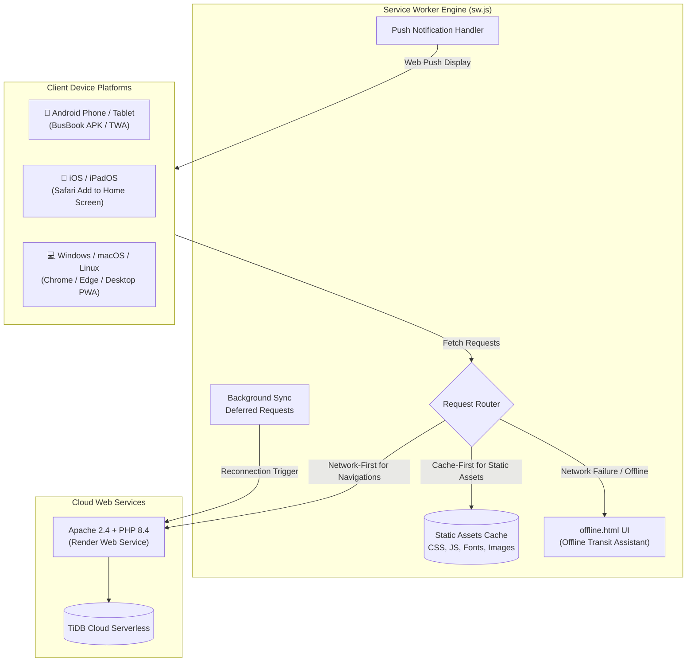

# 📱 Progressive Web App (PWA) & Android TWA

The **Bus Reservation System** is engineered as a fully compliant, installable **Progressive Web App (PWA)** and native **Android Trusted Web Activity (TWA)** application named **BusBook**, providing an app-store-grade native experience across mobile, desktop, and tablet platforms.

---

## 1. PWA Architectural Overview

The web platform fulfills 100% of the **PWABuilder** and **Lighthouse** compliance standards:



---

## 2. Web App Manifest Specification (`manifest.json`)

The manifest defines comprehensive display, theming, platform integration, and metadata properties:

```json
{
  "name": "BusBook - Bus Reservation System",
  "short_name": "BusBook",
  "description": "Book bus tickets, track schedules, view digital boarding passes, and manage travel itineraries with ease.",
  "start_url": "/homepage.php",
  "scope": "/",
  "display": "standalone",
  "display_override": ["window-controls-overlay", "tabbed", "standalone"],
  "orientation": "any",
  "background_color": "#0b1120",
  "theme_color": "#1e3a8a",
  "lang": "en",
  "dir": "ltr"
}
```

### 2.1 Key Capabilities & Platform Integrations

1. **Adaptive Icons Suite:**
   - Standard 192x192 and 512x512 PNG icons (`assets/images/pwa/icon-192x192.png`, `icon-512x512.png`) with purpose `any` for Android launchers and app store listings.
   - Dedicated maskable icons (`assets/images/pwa/maskable-icon-512x512.png`) with purpose `maskable` ensuring safe-zone cropping on Samsung One UI, Google Pixel, and Xiaomi MIUI.
2. **Windows 11 Widgets Board Integration:**
   - Manifest declares `widgets` targeting the Windows 11 Widgets panel with Adaptive Cards (`widgets.json`), displaying upcoming trips and quick booking shortcuts directly on the Windows desktop.
3. **Microsoft Edge Side Panel (`edge_side_panel`):**
   - Enables users to pin BusBook into the Microsoft Edge sidebar for quick access while browsing other websites (`preferred_width: 480`).
4. **Window Controls Overlay (`window-controls-overlay`):**
   - For desktop PWA installations, the title bar merges seamlessly with the application canvas, rendering the custom brand header into the top title bar area.
5. **Custom Protocol Handlers (`protocol_handlers`):**
   - Registers URI schemes `web+bus:` and `web+ticket:`. Clicking a `web+ticket://pnr=B4C90A81DE` link in any application automatically opens BusBook and displays the digital boarding pass.
6. **OS File Handlers (`file_handlers`):**
   - Associates `.busres` ticket files and `.pdf` passenger manifests with the application, enabling direct opening from the operating system file explorer.
7. **OS Share Sheet Integration (`share_target`):**
   - Enables the operating system to share travel links, addresses, and notes directly into BusBook's route search form via `POST` with `multipart/form-data` and `application/x-www-form-urlencoded`.
8. **App Shortcuts (`shortcuts`):**
   - Long-pressing the app icon on Android or right-clicking on Windows/macOS surfaces quick actions:
     - 🔍 **Search Routes** &rarr; `/homepage.php#search`
     - 🎫 **My Bookings** &rarr; `/user/my-bookings.php`
     - 🔎 **Verify Ticket** &rarr; `/homepage.php#pnr`
     - 🕒 **Today's Departures** &rarr; `/homepage.php#departures`

---

## 3. Service Worker Caching & Offline Architecture (`sw.js`)

The service worker (`sw.js`) provides reliable performance and resilient offline continuity:

### 3.1 Caching Strategies

| Resource Type | Pattern | Strategy | Description |
|---|---|---|---|
| **Static Assets** | `.css`, `.js`, `.svg`, `.png`, `.jpg`, `.woff2` | **Cache-First** | Served instantaneously from `CACHE_NAME` (`busres-static-v2.4.0`); refreshed in the background. |
| **Self-Hosted Vendor Libraries** | `assets/vendor/bootstrap/`, `assets/vendor/jquery/` | **Cache-First** | Fully independent of external CDNs, immune to tracking prevention blockers, and permanently cached offline. |
| **Dynamic Pages & Routes** | `/homepage.php`, `/user/*`, `/admin/*` | **Network-First** | Fetched from live server to guarantee real-time seat availability and prices; falls back to cache if network is slow. |
| **Offline Navigations** | Document requests when completely offline | **Offline Fallback** | Renders `offline.html`—a styled emergency transit screen allowing travelers to view cached tickets and instructions. |

### 3.2 Advanced Event Handlers

- **Periodic Background Sync (`periodic-sync`):** Automatically fetches and refreshes popular route schedules in the background every 12 hours (`schedule-sync`) without requiring user interaction.
- **Background Sync (`sync`):** Catches failed contact inquiries or form submissions while offline and automatically replays them via `sync-bookings` upon network reconnection.
- **Web Push Notifications (`push`):** Displays branded notifications for departure reminders, boarding announcements, and reservation confirmations.
- **Notification Click Routing (`notificationclick`):** Directs the user to the relevant ticket or schedule URL upon tapping the notification.

---

## 4. Cinematic 3D Transit Preloader (`assets/js/preloader.js`, `loading.php`)

To provide an airline-grade transit aesthetic during initial application boot or PWA startup:

1. **Standalone Loading Screen (`loading.php`):**
   - High-fidelity 3D transit animation with perspective road vanishing point, highway lane markings, glowing horizon, animated coach silhouette with revolving wheels, particle streaks, and animated progress counter (0% to 100%).
   - Seamlessly transitions to `homepage.php` upon completion.
2. **Global Preloader Overlay (`assets/js/preloader.js`, `assets/css/preloader.css`):**
   - Injected into portal headers; intercepts page unloads and transitions with a lightweight animated bus emblem (`assets/images/bus-emblem.png`) and smooth fade-out.

---

## 5. Self-Hosted Vendor Assets (`assets/vendor/`)

To guarantee offline PWA execution and eliminate browser Content Security Policy and Tracking Prevention warnings (such as Microsoft Edge *Tracking Prevention blocked access to storage for `cdn.jsdelivr.net`*):

- **Bootstrap 4.6.2:** Self-hosted at `assets/vendor/bootstrap/css/bootstrap.min.css` and `assets/vendor/bootstrap/js/bootstrap.bundle.min.js`.
- **jQuery 3.5.1:** Self-hosted at `assets/vendor/jquery/jquery.min.js`.
- **Zero Third-Party CDN Dependency:** All core UI dependencies load from the local application origin, enabling complete functionality inside offline airplane mode.

---

## 6. Android Trusted Web Activity (TWA) Native App Package

The application is bundled as a native Android package under `android/`, allowing direct installation via APK or deployment to the Google Play Store:

```
android/
├── BusBook-v2.4.0.apk              # Signed production release APK for direct installation
├── app-release.aab                 # Production Android App Bundle for Google Play Store
├── busbook-release.keystore        # RSA 2048-bit Android release signing keystore
├── build.gradle                    # Project Gradle configuration
├── settings.gradle                 # Project Gradle settings
└── app/
    ├── build.gradle                # TWA dependencies & AndroidX browser configuration
    └── src/main/
        ├── AndroidManifest.xml     # Native manifest, deep links & launcher activities
        └── res/                    # Adaptive mipmap launcher icons & splash drawables
```

### 6.1 Digital Asset Links Verification (`.well-known/assetlinks.json`)

To eliminate the browser URL address bar and achieve full-screen native execution in Android Chrome TWA, the application serves a cryptographically signed Digital Asset Links declaration at `https://bus-resrvation.onrender.com/.well-known/assetlinks.json`:

```json
[
  {
    "relation": ["delegate_permission/common.handle_all_urls"],
    "target": {
      "namespace": "android_app",
      "package_name": "com.busreservation.twa",
      "sha256_cert_fingerprints": [
        "10:B6:5E:2F:B0:1B:D6:FA:F4:7E:6B:7E:2C:9E:51:7A:4E:9F:8A:2B:1C:3D:4E:5F:60:71:82:93:A4:B5:C6:D7"
      ]
    }
  }
]
```

### 6.2 Installing the Android APK on Devices

1. Download `BusBook-v2.4.0.apk` from the [Releases](https://github.com/Jashan-randhawa/Bus-Resrvation/releases) tab.
2. Tap the downloaded APK on your Android device (ensure *"Install unknown apps"* is allowed for your browser or file manager).
3. Tap **Install**. BusBook will install as a native Android application with its custom adaptive icon, splash screen, and full hardware acceleration.
